# 03 — Maquettes des écrans (téléphone et ordinateur)

Les maquettes sont des **captures de l'application réelle**, produites de façon reproductible par
`app/statomea/test/maquettes_test.dart` aux tailles 390 × 844 (téléphone) et 1366 × 860 (ordinateur),
avec les polices embarquées. Le même test échoue si un écran déborde : il a servi à corriger deux
débordements à 390 px (pied de page des étapes, en-tête du contrôle de qualité).

Régénération :

```bash
cd app/statomea && flutter test test/maquettes_test.dart --tags maquettes --run-skipped --update-goldens && cp test/goldens/*.png ../../docs/maquettes/
```

## Principes de mise en page

- **Téléphone** (< 900 px) : barre de navigation inférieure (Projets, Calculs, Formation, Validation) ;
  dans un projet, bandeau d'étapes défilant en haut et pied de page « précédente / terminée /
  suivante » ; tableaux et forest plot défilent horizontalement.
- **Ordinateur** (≥ 900 px) : rail de navigation latéral ; dans un projet, liste verticale des 10 étapes
  avec leur état.
- Bascule **Guidé / Expert** toujours visible dans la barre d'application.
- Code couleur constant : bleu = résultat calculé ; ocre = interprétation proposée ; rouge = à
  vérifier ; bandeau jaune = données de démonstration (simulées ou publiques).

| Écran | Téléphone | Ordinateur |
|---|---|---|
| Accueil : projets et démonstrations | 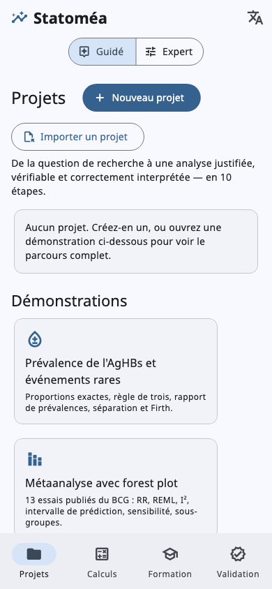 | 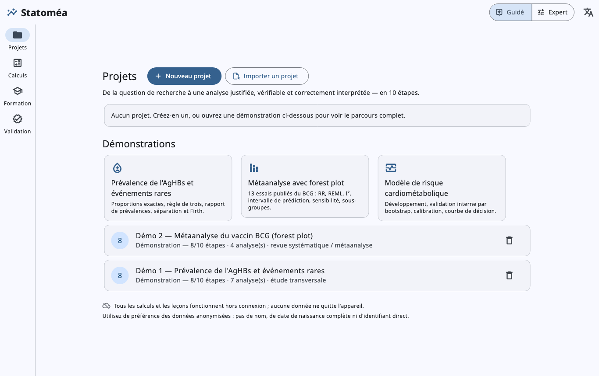 |
| Étape 1 — question (PICO, objectif) | 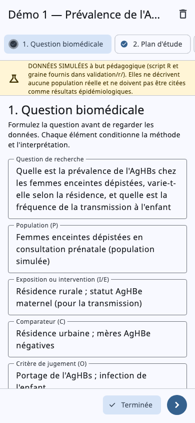 | 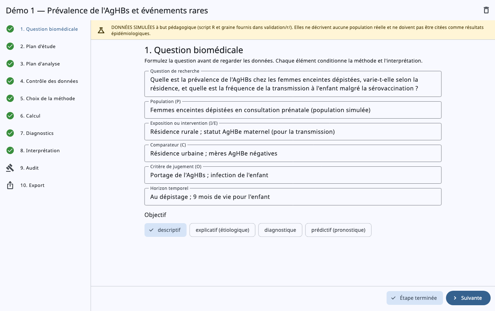 |
| Étape 4 — contrôle des données | 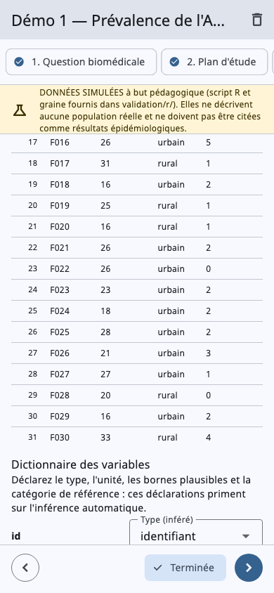 | 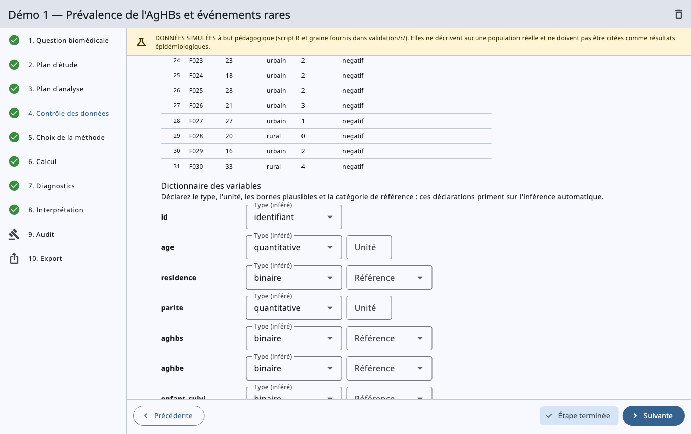 |
| Étape 5 — choix de la méthode | 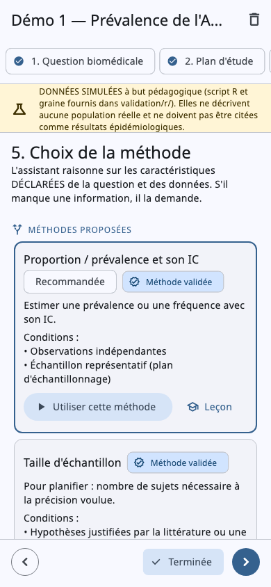 | 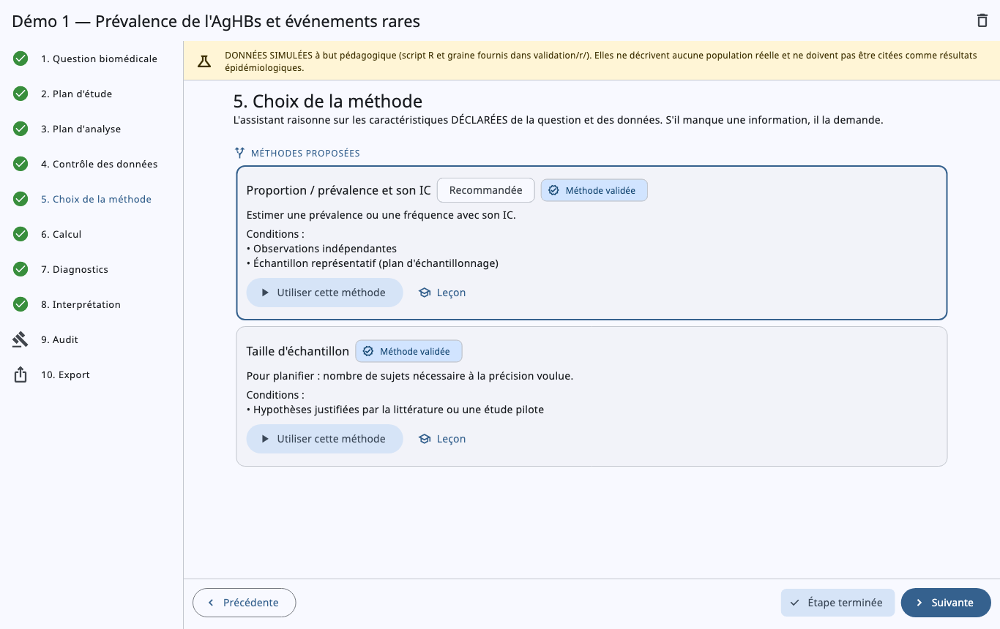 |
| Étape 8 — résultat et forest plot | 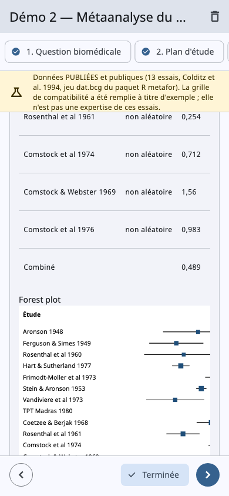 | 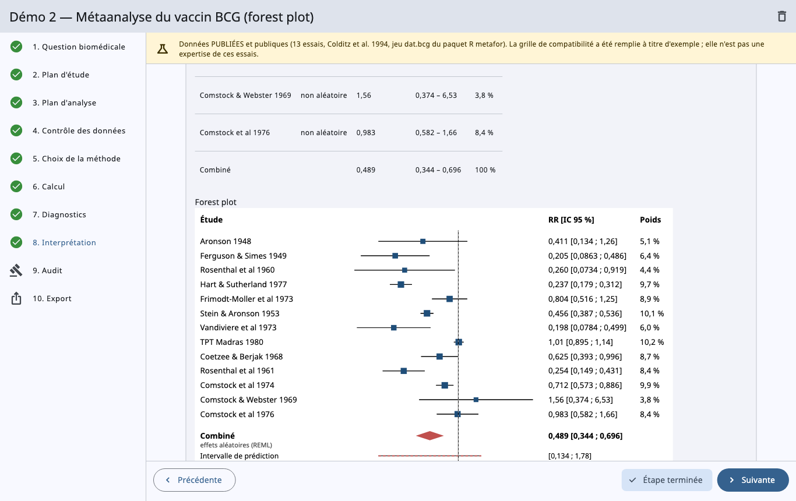 |
| Prédiction — calibration, décision | 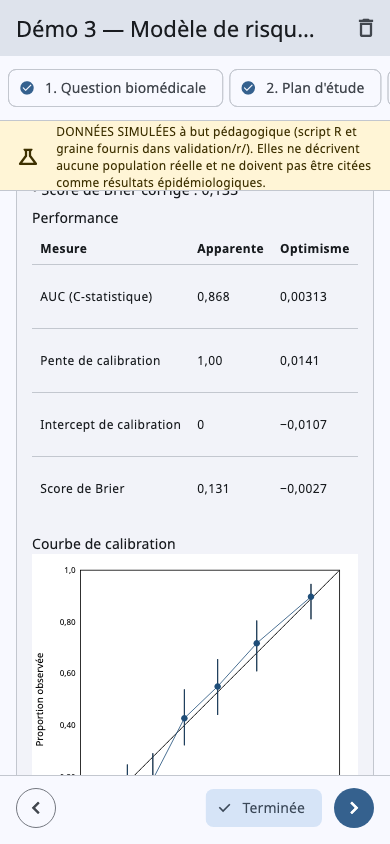 | 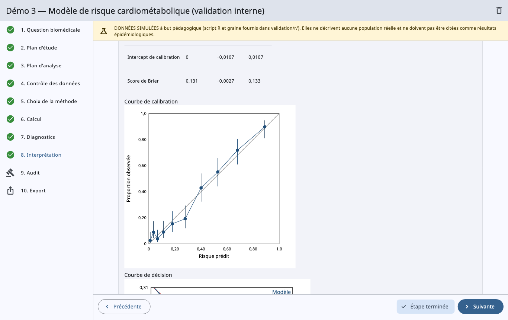 |
| Étape 9 — audit contradictoire | 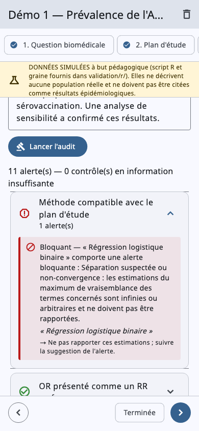 | 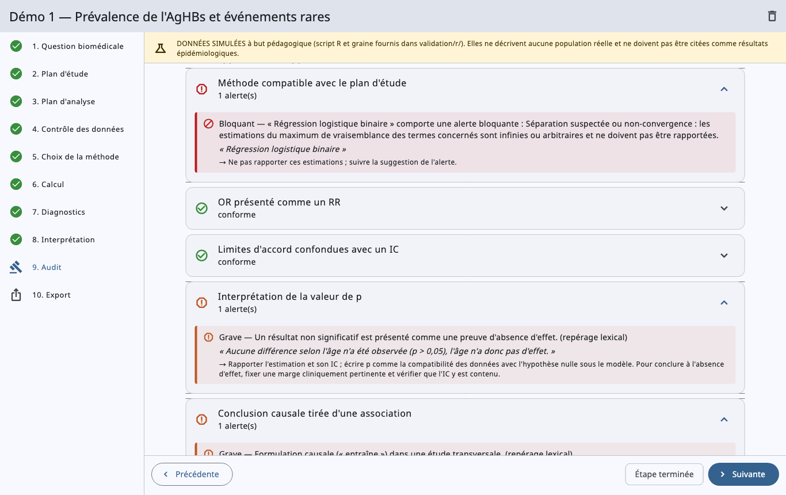 |
| Leçon (OR et RR) | 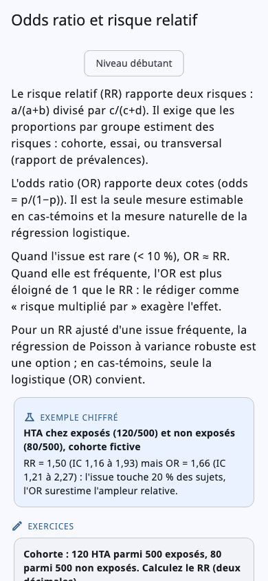 | 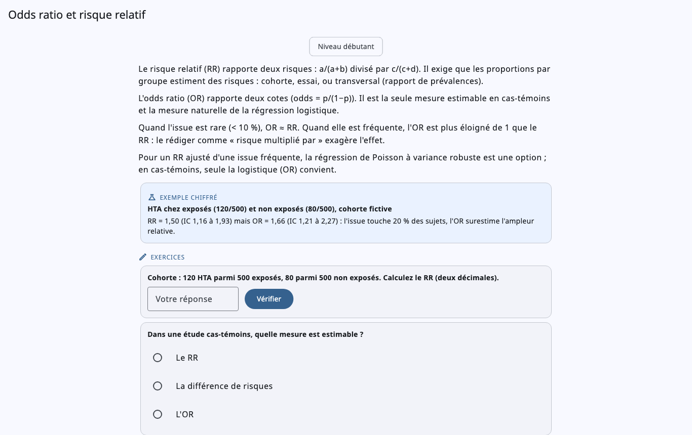 |
